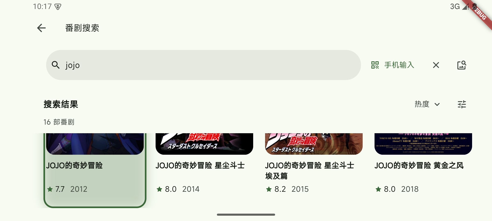

# KazumiTV（个人构建）

为 Android TV / 电视盒子设计的番剧浏览与播放应用。基于
[znbsf/KazumiTV](https://github.com/znbsf/KazumiTV) v0.4.6 构建，
延续上游的 Flutter/Dart 业务、规则系统与 media-kit 播放能力。

**这是个人维护的派生构建，不是上游官方版本，也不是官方 Release。**
当前版本在 0.4.6 基础上完成了电视端全模块遥控回归的 19 项修复，
并保留 GPL-3.0 许可与上游署名。

- 上游 TV 项目：[znbsf/KazumiTV](https://github.com/znbsf/KazumiTV)
- 基础应用：[Predidit/Kazumi](https://github.com/Predidit/Kazumi)
- 回归报告：[docs/TV-EMULATOR-FULL-QA-20261102.md](docs/TV-EMULATOR-FULL-QA-20261102.md)

## 下载

安装包见 [Releases](https://github.com/nodonkey/KazumiTV/releases/latest)：

| 文件 | 用途 | SHA256 |
| --- | --- | --- |
| `KazumiTV-0.4.6-arm64.apk` | 电视 / 盒子交付包（arm64-v8a） | `4e93c0958960fe2c63b1980f11187546670bb733eea0aa25d580a6daf88d5e91` |
| `KazumiTV-0.4.6-x86_64-debug.apk` | x86_64 模拟器调试，请勿安装到电视 | `77966b7949fa18c70b31d18c003aba6bc486f5f95cdae7c6d107f82714007a01` |
| `KazumiTV-0.4.6-tv-arm64.zip` | 交付包 + 使用说明 + 校验文件的打包 | 见 Release 附件 |
| `SHA256SUMS.txt` | 上述 APK 的校验清单 | — |

Windows 可用 `certutil -hashfile <文件> SHA256` 核对。

- 包名：`com.si.kazumitv`（与官方 Kazumi 共存，不会覆盖）
- 版本：0.4.6（versionCode 20667）
- 最低系统：Android 7.0（API 24）
- 签名：Android 调试证书，适合个人侧载，不适合上架应用商店

## 本次修复

2026-11-02 在 Android 15 x86_64 模拟器上完成了覆盖主页、详情、播放器、
搜索、排期、历史、收藏、个人中心、设置、规则管理、手机遥控的遥控回归，
共修复 19 项问题，逐项证据见回归报告与
[docs/screenshots/qa-20261102](docs/screenshots/qa-20261102)。

- **播放器**：选集抽屉焦点泄漏、方向键误关闭抽屉、重载卡死；WebView 调试
  日志覆盖视频；来源面板无初始焦点；错误页方向键穿越到工具栏；状态栏重叠
  与白色 letterbox。
- **搜索**：输入弹窗被输入法遮挡；结果页 DOWN 落点不稳定，搜索框与
  “搜索结果 / 排序 / 筛选”行被滚出屏幕。
- **浏览页**：收藏页初始焦点、排序菜单 BACK 退出整页；历史空态底部溢出；
  排期页初始焦点与首个 DOWN 落点；个人中心卡片焦点不可见。
- **设置 / 规则**：返回侧栏后焦点残留；规则管理 RIGHT 落到底部搜索框；
  添加规则弹窗第二项被遮挡。
- **手机遥控**：焦点提示弱、易误触“暂停遥控”；URL 单字符断行。
- **导航**：功能栏 UP 无响应；主页连续 BACK 退出应用。

复测在移除全部 QA 调试代码后的 clean 构建上完成，19 项均通过。
复测另发现“同集换源”弹窗底部溢出 88px，未计入本轮修复范围，记录在
回归报告中。

## 可以做什么

- **遥控器浏览**：单排横向导航、五列海报卡片、向下持续加载；返回时恢复
  浏览位置。
- **找番与看资料**：分类目录、搜索、排期、作品详情、角色与关联作品。
- **管理播放来源**：导入与管理规则，搜索可用来源，选择线路和剧集。
- **接着看**：收藏、历史记录与分集续播。
- **内置播放**：暂停、进度、选集、倍速、音轨、字幕与弹幕设置；实际能力
  取决于媒体与来源。
- **手机遥控**：电视显示二维码与局域网地址，手机浏览器直接当遥控器，
  也可用于搜索页文字输入。

## 截图

| 首页 | 搜索结果（头部固定） |
| --- | --- |
|  |  |

## 构建

环境：Flutter 3.47.8、JDK 21、Android SDK 36、Gradle 8.14.5。

```bash
# 电视交付包（arm64）
flutter build apk --release --flavor tv \
  --android-project-arg=kazumiTv=true \
  --android-project-arg=kazumiTvApplicationId=com.si.kazumitv \
  --android-project-arg=kazumiTvLabel=KazumiTV \
  --target-platform android-arm64 \
  --dart-define=KAZUMI_TV_PERF=false \
  --dart-define=KAZUMI_TV_FIXED_SURFACES=true

# x86_64 模拟器调试包
flutter build apk --debug --flavor tv \
  --android-project-arg=kazumiTv=true \
  --android-project-arg=kazumiTvApplicationId=com.si.kazumitv \
  --android-project-arg=kazumiTvLabel=KazumiTV \
  --target-platform android-x64
```

说明：

- TV 产品风味由 Gradle 属性 `kazumiTv=true` 启用；未传该属性时不存在 `tv` flavor。
- `android/gradle.properties` 关闭了 Kotlin 增量编译：插件源码与工程分属
  C:/D: 两个盘时，跨盘缓存无法相对化会构建失败。
- `pubspec.yaml` 的 Flutter 约束由 3.47.3 调整为 3.47.8，与构建环境一致。
- 更完整的构建与发布流程见
  [docs/TV_BUILD_AND_RELEASE.md](docs/TV_BUILD_AND_RELEASE.md)。

## 安装与使用

```bash
adb connect <电视IP>:5555
adb install -r KazumiTV-0.4.6-arm64.apk
```

也可将 APK 拷到 U 盘，用电视文件管理器安装。

首次启动：使用约定（同意并继续）→ 镜像选择（大陆网络建议开启）→ 规则
（可直接“仍然继续”，之后在“设置 → 规则管理”补充）→ 开始使用。

主页顶部依次为：个人中心（含设置入口）、手机遥控、搜索、排期、历史、收藏，
右侧是分类标签。手机遥控需电视与手机处于同一局域网。

## 测试

```bash
flutter test test/tv_focus_regression_test.dart \
             test/tv_settings_navigation_test.dart \
             test/tv_search_date_range_test.dart
```

完整回归范围、证据与覆盖限制见
[docs/TV-EMULATOR-FULL-QA-20261102.md](docs/TV-EMULATOR-FULL-QA-20261102.md)。
主要限制：仅在 x86_64 模拟器验证 UI 与遥控焦点，未覆盖真实电视的硬件解码、
4K/1080p 性能与实体遥控器差异；收藏/历史为空数据，未验证条目级交互。

## 目录结构

```
lib/                Flutter 业务、页面与 TV 焦点组件
test/               焦点与导航回归测试
android/            Android TV 工程（tv.gradle 定义 TV 风味）
docs/               回归报告、发布与工程文档、截图证据
assets/ static/     资源与内置页面
native-history/     上游原生历史资料
```

## 许可与致谢

- 许可证：**GPL-3.0**，见 [LICENSE](LICENSE)
- 上游 TV 项目：[znbsf/KazumiTV](https://github.com/znbsf/KazumiTV)，
  基线提交 `3890b31`（v0.4.6）
- 基础应用：[Predidit/Kazumi](https://github.com/Predidit/Kazumi)
- 第三方组件与许可见 [THIRD_PARTY_NOTICES.md](THIRD_PARTY_NOTICES.md)

## 免责声明

本应用只提供聚合与播放能力，番剧内容来自用户自行添加的规则与第三方站点。
源站失效、限流或需要额外验证时可能无法播放；请遵守当地法律法规与内容
服务条款。
